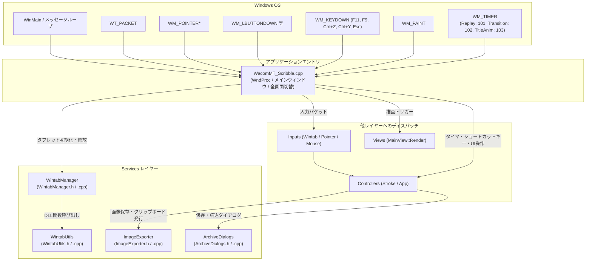

# 基盤サービス & アプリケーションエントリ (Services & Entry)

本レイヤーは、Windows OS との対話、Win32 メインウィンドウの生成とメッセージループ、Wintab デバイスドライバとのコンテキスト接続・管理、ならびに完成した作品の画像保存（BMP / WIC PNG）やクリップボード連携を担うインフラストラクチャ層です。

---

## 1. ファイル構成と関係性

アプリケーションのエントリポイントである [`WacomMT_Scribble.cpp`](../App/FudeCode/WacomMT_Scribble.cpp) がOSのメッセージループを駆動し、デバイス管理を [`WintabManager`](../App/FudeCode/Services/WintabManager.h) に委譲します。画像エクスポートの [`ImageExporter`](../App/FudeCode/Services/ImageExporter.h) と運筆アーカイブのファイル選択 [`ArchiveDialogs`](../App/FudeCode/Services/ArchiveDialogs.h) は、[`AppController`](../App/FudeCode/Controllers/AppController.h) から呼ばれます。

---

## 2. 各プログラムファイルの詳細

### 2.1 [WacomMT_Scribble.cpp](../App/FudeCode/WacomMT_Scribble.cpp) / [WacomMT_Scribble.h](../App/FudeCode/WacomMT_Scribble.h)

- **責務 (Responsibility)**:
  - アプリケーションのエントリポイント（`_tWinMain` / `WinMain`）とメインウィンドウプロシージャ（`WndProc`）を含みます。
  - **状態の実体**: `g_appState`（[`AppState`](../App/FudeCode/Models/AppState.h)）と `g_uiState`（[`UIState`](../App/FudeCode/Views/UIState.h)）を持ち、Controller と View へ引数で渡します。
  - **メッセージディスパッチ**:
    - `WT_PACKET`: Wintab アダプタ経由で [`StrokeController`](../App/FudeCode/Controllers/StrokeController.h) へ転送。
    - `WM_POINTERDOWN` / `WM_POINTERUPDATE` / `WM_POINTERUP`: Windows Pointer アダプタ経由で [`StrokeController`](../App/FudeCode/Controllers/StrokeController.h) へ転送。
    - `WM_LBUTTONDOWN` / `WM_MOUSEMOVE` / `WM_LBUTTONUP`: [`AppController`](../App/FudeCode/Controllers/AppController.h) またはマウスアダプタへ転送。
    - `WM_CHAR`: お手本文字の入力ハンドリング（IME確定文字）。
    - `WM_PAINT`: [`MainView::Render`](../App/FudeCode/Views/MainView.h) の実行。
    - `WM_CREATE`: [`ScreenLayout::Layout`](../App/FudeCode/Views/ScreenLayout.h) による最初のレイアウト計算、描画エンジンとタブレットの初期化。
    - `WM_SIZE`: `AppController::OnSize` へ転送（レイアウト再計算と描画エンジンのリサイズ）。
    - `WM_SETCURSOR`: `AppController::OnSetCursor` へ転送。
    - `WT_PROXIMITY`: ペンが圏外へ出たらストロークを終え、`AppController::OnPenOutOfRange` で入力ロックなどを解除。
    - `WM_TIMER`: `AppController::OnTimer` へ転送。
      - `REPLAY_TIMER_ID` (`101`): 運筆リプレイ再生時刻の進行。
      - `TRANSITION_TIMER_ID` (`102`): タイトル画面からスタジオ画面へのアルファブレンド遷移演出の進行。
      - `TITLE_ANIM_TIMER_ID` (`103`): タイトル画面でのロゴ・テキストのブレスアニメーション更新。
  - **キーボードショートカット制御**（`F11` と `Alt + /` 以外は `AppController::OnKeyDown` で処理）:
    - `F11`: `ToggleFullscreen` によるボーダーレス全画面表示切替（マルチモニタ対応、元のウィンドウスタイルと配置を完全退避・復元。お手本入力中も常時有効）。
    - `F9`: 紙を大きくする（横向き）表示の切り替え（`AppController::SetPaperOnly`）。
    - `Esc`: 全消し確認モーダルの呼び出し / モーダル表示中のキャンセル。
    - `Ctrl + Z`: 一画戻す（`AppController::UndoStroke`）。
    - `Ctrl + Shift + Z` / `Ctrl + Y`: 一画復元（`AppController::RedoStroke`）。
    - `Alt + /` / `Alt + ?`: バージョン情報ダイアログ（About）。
  - **入力保護 ([`IsStudioAcceptingKeys`](../App/FudeCode/WacomMT_Scribble.cpp#L82))**:
    - タイトル画面および画面遷移中は、F11 以外のすべてのショートカットを遮断し、裏でスタジオ状態が変わることを防止。
    - お手本文字の入力中（`ui.interaction.isTyping`）は、`F11` と `F9` 以外のショートカットを `AppController::OnKeyDown` で一時遮断。
- **入力 (Input)**:
  - Windows メッセージ（`HWND`, `UINT message`, `WPARAM wParam`, `LPARAM lParam`）
- **出力 (Output)**:
  - `LRESULT`: メッセージ処理結果
- **使用されている定数の名前 (Constants used)**:
  - ウィンドウタイトル: `szTitle = L"Fude Sense"`
  - ウィンドウクラス名: `szWindowClass = L"FUDESENSE"`
  - `REPLAY_TIMER_ID`: リプレイ進行用タイマ識別子 (`101`)。終了時に止めます。タイマの ID は [`AppController.h`](../App/FudeCode/Controllers/AppController.h) で定義しています。
  - `TITLE_ANIM_TIMER_ID`: タイトルブレス用タイマ識別子 (`103`)。起動時に開始します。

---

### 2.2 [WintabManager.h](../App/FudeCode/Services/WintabManager.h) / [WintabManager.cpp](../App/FudeCode/Services/WintabManager.cpp)

- **責務 (Responsibility)**:
  - `wintab32.dll` との接続を確立し、ペンタブレットの論理コンテキスト（`HCTX`）のオープン・クローズおよびデバイス特性情報の取得を管理します。
  - デバイスごとの最大筆圧（`maxPressure`）、タブレット物理解像度（`tabletXExt`, `tabletYExt`）、液晶タブレットか板タブレットかの判定を行い、コンテキストマップ（`m_contextMap`）で保持します。
- **入力 (Input)**:
  - `HWND hWnd`: 接続先メインウィンドウハンドル
- **出力 (Output)**:
  - `GetMaxPressure(HCTX hCtx)`: 対象コンテキストの最大筆圧値（フォールバック時 `1024.0`）
  - `GetPrimaryContext()`: プライマリコンテキストハンドル
- **使用されている定数の名前 (Constants used)**:
  - `PACKETDATA`: パケット取得フラグ（`PK_X | PK_Y | PK_Z | PK_BUTTONS | PK_NORMAL_PRESSURE | PK_TANGENT_PRESSURE | PK_TIME | PK_ORIENTATION`）。
  - `PACKETMODE`: ボタンモードフラグ (`PK_BUTTONS`)。

---

### 2.3 [WintabUtils.h](../App/FudeCode/Services/WintabUtils.h) / [WintabUtils.cpp](../App/FudeCode/Services/WintabUtils.cpp)

- **責務 (Responsibility)**:
  - `wintab32.dll` を動的ロード（`LoadLibraryA`）し、Wintab API の関数ポインタ（`WTInfoA`, `WTOpenA`, `WTPacket`, `WTClose` など）を解決・エクスポートする低レベルユーティリティモジュールです。
  - タブレットドライバがインストールされていない環境でも安全に初期化エラーを検出し、クラッシュを防ぎます。
- **入力 (Input)**:
  - なし（DLLロード関数）
- **出力 (Output)**:
  - 各種グローバル関数ポインタ（`gpWTInfoA`, `gpWTOpenA`, `gpWTPacket` 等）
- **使用されている定数の名前 (Constants used)**:
  - DLL名: `"wintab32.dll"`。

---

### 2.4 [ImageExporter.h](../App/FudeCode/Services/ImageExporter.h) / [ImageExporter.cpp](../App/FudeCode/Services/ImageExporter.cpp)

- **責務 (Responsibility)**:
  - 渡された作品画像のビットマップを、デスクトップへの画像ファイル保存（WIC PNG / BMP 形式）またはクリップボードへの転送（`CF_BITMAP` 形式）で書き出す画像エクスポートサービスです。作品画像の合成は [`CanvasView::ComposeArtwork`](../App/FudeCode/Views/CanvasView.h) が行います。
  - **クリップボードへの転送 (`CopyToClipboard`)**:
    - 転送に成功するとビットマップの所有権がシステムへ移るので、呼び出し側は破棄しません。失敗したときは呼び出し側で破棄します。
  - **画像ファイルの保存 (`SaveToDesktop`)**:
    - WIC で PNG を保存し、失敗したときは BMP で保存します。ビットマップは呼び出し側で破棄します。
  - **ファイル命名規則**:
    - デスクトップ上に `習字作品_YYYYMMDD_HHMMSS.png`（WIC失敗時は `.bmp`）として保存。
  - **破損ファイルのクリーンアップ**:
    - 保存途中で容量不足や書き込み失敗が発生した場合、壊れたファイルを残さないよう直ちに削除（`DeleteFileW`）を実行。
  - **結果の通知**:
    - 結果を `ImageExportResult` で返すだけで、画面の状態には書き込みません。メッセージは [`AppController`](../App/FudeCode/Controllers/AppController.h) が設定します。
- **入力 (Input)**:
  - `HWND hWnd`: 親ウィンドウ
  - `HBITMAP hBmp`: 書き出す作品画像
  - `int width`, `int height`: 作品画像の大きさ（`SaveToDesktop` のみ）
- **出力 (Output)**:
  - ファイル出力（デスクトップ上に `習字作品_YYYYMMDD_HHMMSS.png` または `.bmp`）
  - クリップボードへのビットマップデータ格納 (`CF_BITMAP`)
  - 戻り値 `ImageExportResult`: `Failed`、`CopiedToClipboard`、`SavedPng`、`SavedBmp`
- **使用されている定数の名前 (Constants used)**:
  - `CF_BITMAP`: Win32 クリップボード形式。
  - `GUID_ContainerFormatPng`: WIC (Windows Imaging Component) の PNG エンコーダー GUID。
  - `GUID_WICPixelFormat24bppBGR`: WIC 24bpp BGR ピクセルフォーマット。

---

### 2.5 [ArchiveDialogs.h](../App/FudeCode/Services/ArchiveDialogs.h) / [ArchiveDialogs.cpp](../App/FudeCode/Services/ArchiveDialogs.cpp)

- **責務 (Responsibility)**:
  - 運筆アーカイブのファイル選択ダイアログを開き、選ばれたファイルを [`TrajectorySession`](../App/FudeCode/Models/TrajectoryModel.h) の読み書き処理へ渡します。
  - 結果を `Result` で返し、ユーザーの取り消しと障害を区別します。取り消しでは呼び出し側が何も表示せず、障害のときだけ知らせられます。
- **入力 (Input)**:
  - `HWND hWnd`: 親ウィンドウ
  - `const TrajectorySession& session`: 保存する運筆記録
  - `PaperType paperType`, `Brush brushType`, `double hardness`: JSON に含める設定
  - `TrajectorySession& session`, `const RECT& rPaper`: 読み込み先の記録と半紙の矩形
- **出力 (Output)**:
  - 戻り値 `Result`: `Saved`、`Canceled`、`Failed`
  - `outFileName`, `outError`: 読み込んだファイル名とエラー内容
- **使用されている定数の名前 (Constants used)**:
  - `Result`: ダイアログの結果の列挙値。
